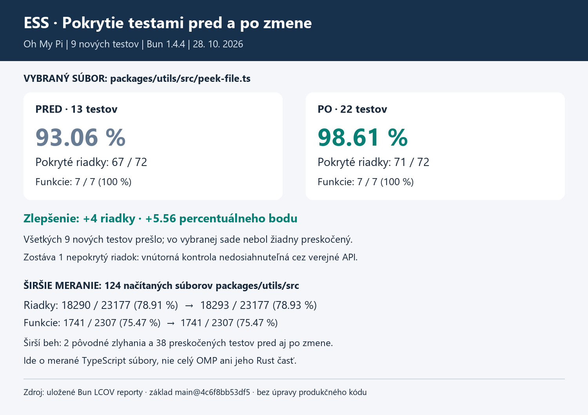

V projekte Oh My Pi som doplnil 9 jednotkových testov čítania začiatku a konca súborov, ktoré sú nezávislé od mojej opravy SSH.
Testy overujú hraničné prípady a zatvorenie súboru pri chybe; na simulovanie chýb čítania a získania informácií o súbore používajú stuby.
Pokrytie riadkov vybraného súboru stúplo zo 67/72 (93,06 %) na 71/72 (98,61 %) a všetkých 22 testov tejto časti prešlo.
Prikladám nové testy, obrázok porovnania a pôvodné reporty; podrobnosti merania vrátane dvoch existujúcich zlyhaní širšej sady na Windows sú v súbore [MERANIE.md](MERANIE.md).

